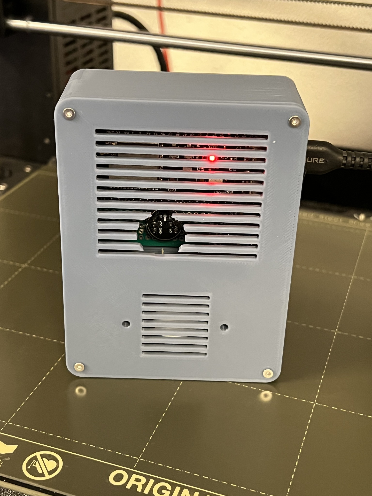
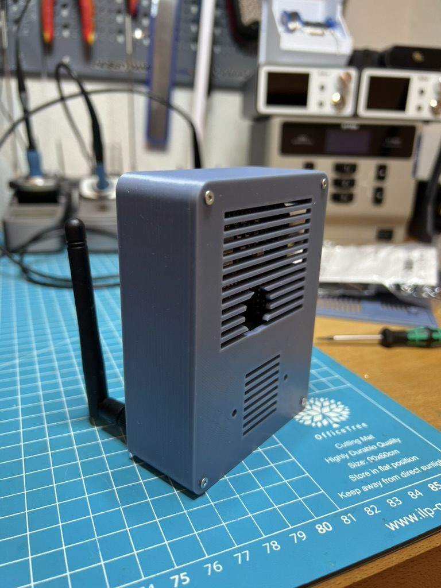
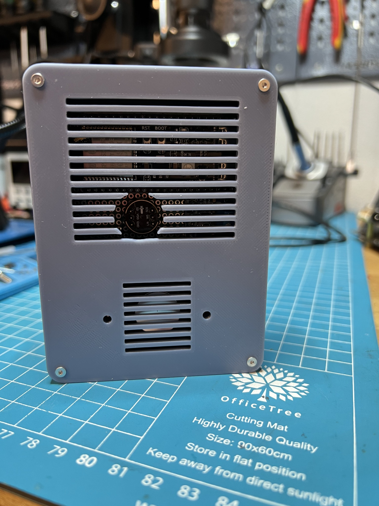
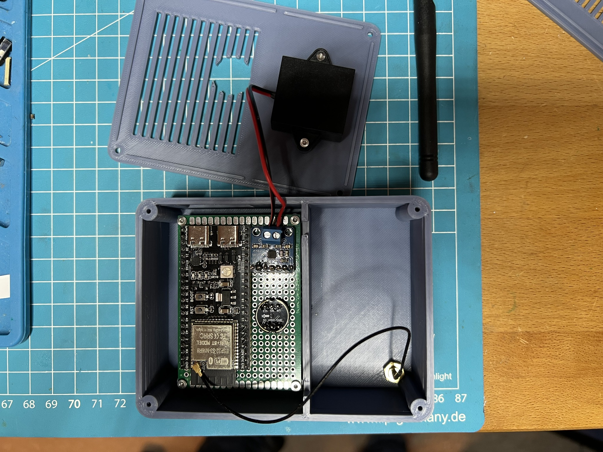

# ESP32-S3 Home Assistant Smart Speaker

A completed DIY voice satellite built on perfboard, in a custom 3D-printed enclosure. Local **Okay Nabu** detection and a local **Stop** wake word run on the ESP32-S3. Home Assistant Cloud provides speech-to-text and text-to-speech; a local Qwen model, connected through Home Assistant's llama.cpp integration, handles conversation and permitted device actions.

**Deutsch:** Fertig aufgebauter ESP32-S3-Sprachsatellit mit INMP441, MAX98357A und gedrucktem Gehäuse. Wakewords und Qwen laufen lokal; STT/TTS nutzen Home Assistant Cloud. Die Originalfotos, finale v0.4-CAD-Quelle und beide Druckteile sind enthalten.






## Features

- ESP32-S3 DevKitC-1, INMP441 I²S microphone, MAX98357A I²S amplifier.
- Local microWakeWord “Okay Nabu”; “Stop” enabled during longer TTS announcements.
- Separate music and announcement pipelines with a mixer and 48 kHz resamplers.
- Home Assistant Cloud STT/TTS with a local Qwen conversation agent.
- Real OpenSCAD source and separate enclosure/front-grille STL files, v0.4, 82 × 110 × 35 mm.

## Start here

1. Check [BOM](hardware/BOM.md) and [wiring](hardware/WIRING.md), including your board's flash/PSRAM variant.
2. Follow [ESPHome setup](esphome/README.md). The supplied YAML is the last complete Stop-enabled configuration recovered from the project chat.
3. Follow [Home Assistant setup](home-assistant/SETUP.md) to select the Cloud STT/TTS and Qwen pipeline on the satellite.
4. Use [CAD and printing](cad/README.md) for the genuine final files and documented coordinate corrections.
5. Read [validation and provenance](docs/VALIDATION.md) and [license status](LICENSE.md).

## How it works

```text
INMP441 → local Okay Nabu → Home Assistant Cloud STT
                                 ↓
                    Home Assistant → local Qwen server
                                 ↓
Cloud TTS → announcement pipeline → resampler → mixer → MAX98357A
Music     → media pipeline        → resampler ↗
```

During announcements longer than roughly one second, the firmware switches to the local Stop model. A detection stops the satellite's announcement and requests the voice session to stop. This does not guarantee cancellation of backend LLM generation or stop media on other devices.

This is a hybrid local/cloud setup: Qwen runs on a separate computer, not on the ESP32. Spoken requests use cloud STT/TTS. A Home Assistant Cloud subscription and internet access are needed for that pipeline.

## Build status and limits

The owner reported the assembled speaker working, including Stop at moderate playback volume. There is no dedicated acoustic echo-cancellation hardware; loud playback can mask Stop. Start tests at 25–30% volume, even though the recovered firmware starts at 70%. The latest v0.4 enclosure files were supplied in the source chat, but the photos alone do not establish which CAD revision was printed.

This repository packages recovered project artifacts. It does not claim a new on-device test or repeat the earlier CAD export verification. See the validation record for checks performed during packaging.

## Repository map

| Directory | Contents |
|---|---|
| `hardware/` | BOM, pin mapping, measured dimensions |
| `esphome/` | Recovered firmware, secrets example, installation guide |
| `home-assistant/` | Cloud voice pipeline, local model and tool setup |
| `cad/` | v0.4 OpenSCAD, STL, previews, original notes and validation |
| `images/` | Four original final-build photos and attribution |
| `docs/` | Provenance, troubleshooting, validation, publishing |

## License

No license selection was recorded for the original project. [LICENSE.md](LICENSE.md) explicitly records the current rights status and third-party dependencies. A public repository alone does not grant an open-source license.

Independent community project; not an official Espressif, ESPHome, Home Assistant, Nabu Casa or Qwen product.
