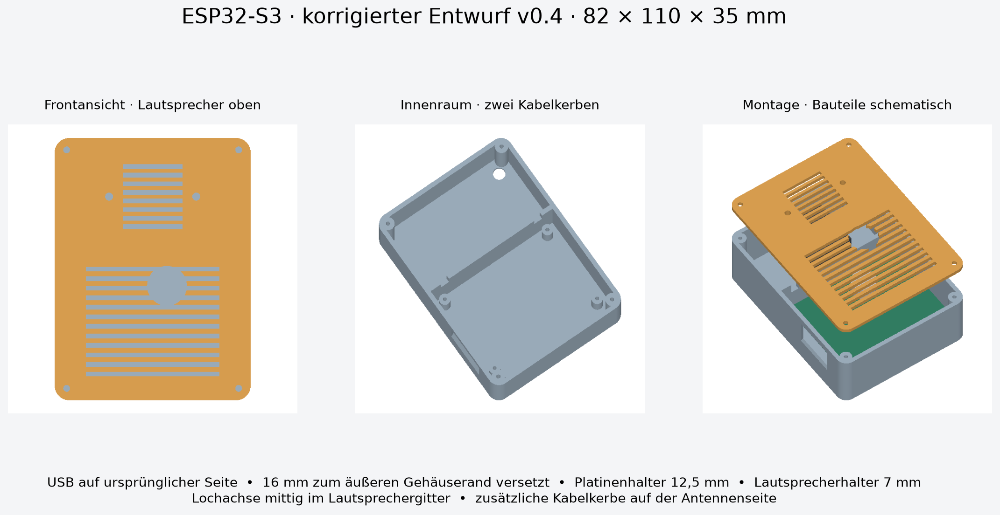

# CAD and 3D printing — recovered v0.4

These are the actual parametric OpenSCAD source and STL exports from the previous enclosure work project. They match the files in the uploaded `esp32_s3_gehaeuse_v04.zip` byte for byte. They are not reconstructed from photographs.

- `smart_speaker_v04.scad`: editable source.
- `gehaeuse_v04.stl`: body, rear wall on print bed.
- `frontgitter_v04.stl`: front grille, visible face on bed, mounts up.
- `vorschau_v04.png`, `massskizze_v04.png`, `usb_position_v04.png`: original previews.
- `upstream-README.de.md`: original detailed German design notes.
- `pruefung_v04.json`: historical digital validation, preserved unchanged.



Scale 1:1, mm; assembled outer size 82 × 110 × 35. Start with 0.4 mm nozzle, 0.2 mm layers, four perimeters, 5–6 bottom layers and 20–30% infill in PLA or PETG. These are starting settings from the original notes, not the recorded settings of the photographed print. Local support may be needed under the USB opening.

```sh
openscad -D 'part="body"' -o gehaeuse_v04.stl smart_speaker_v04.scad
openscad -D 'part="lid"' -o frontgitter_v04.stl smart_speaker_v04.scad
```

The default `part="print"` arranges the two printed parts. Other views: `assembly`, `exploded`, `components`. Component envelopes are schematic. Render and recheck fit after changing parameters.

Mount the board on its four posts, route speaker and antenna wires through the two partition notches, attach the speaker to the grille with suitable M3 hardware, inspect cable/pin clearance, then fasten the grille. Screw lengths must be selected from the real parts. A thin compliant speaker gasket was suggested as a possible future improvement, not confirmed as installed.

See [measurements and discrepancies](../hardware/DIMENSIONS.md), particularly the corrected microphone coordinates and antenna orientation. Do not replace the final 12.5 mm posts with earlier planning values without revisiting the fit.

The owner supplied final-build photos and reported a completed assembly. A photo-to-CAD-revision match and a new physical fit test were not performed during packaging.
